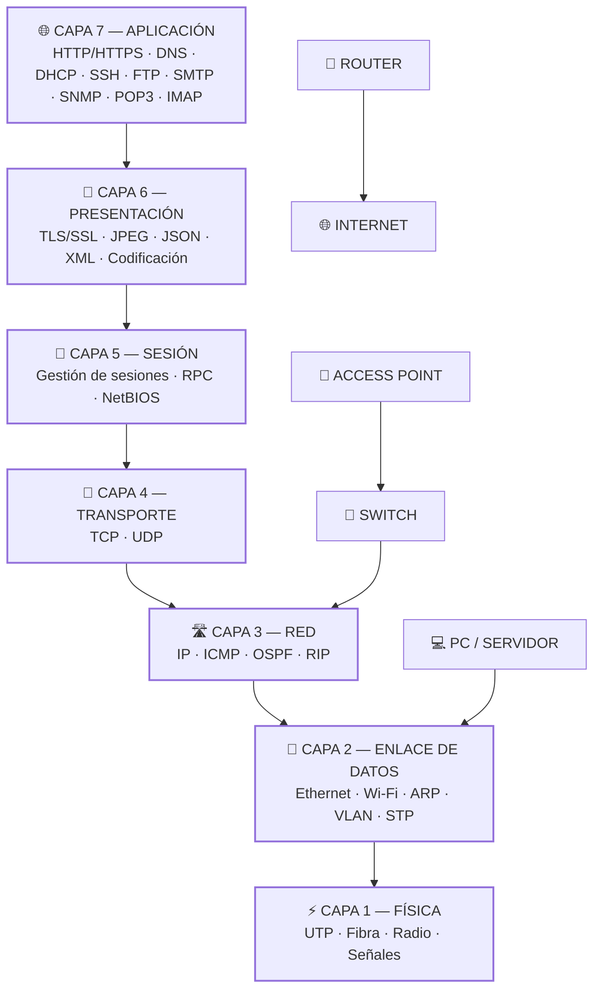

# VLANs (Virtual Local Area Networks)

## ¿Qué es un network?

Es un sistema de dispositivos o partes conectadas donde transfieren datos y estan interconectados entre si, por medio de 
adaptadores de red puede intercomunicarse entre diferente medios ya sea cablea, wifi o algún otra tecnologia.

## ¿Qué es una LAN?
Local area network or LAN es un conjunto de dispositivos entre si conectadas dentro de una area fisica, sea esta una casa,
oficina, etc. Puede tener un solo usuario hasta miles de usuarios y dispositivos conectados. Su principal caracteristica 
es que conecta dispositivos en un area geográfica limitada.

 ### LAN cliente / servidor 
 Consta de varios dispositivos (clientes) conectados a un servidor. El servidor gestiana accesos, 
 aplicaciones y trafico de red.
 ### LAN punto a punto 
 No tiene un servidor central y cualquier dispositivo comparten recursos y datos por medios de cableados
 o red inalambrica.

## ¿Qué es una WAN?
Una red amplia es cualquier red que existe por una gran zona geográfica, interconectando varias redes LAN

# CAPAS DE PROTOCOLO

| Protocolo | Descripción |
|---------|------------|
| HTTP | Protocolo de transferencia de hipertexto permite la comunicación entre navegadores web y servidores en internet |
| HTTPS | Es la versión cifrada y segura del protocolo HTTP que protege los datos entre  un navegador web y el servidor |
| DNS  |
| DHCP | Si el router falla, se corta el ruteo |