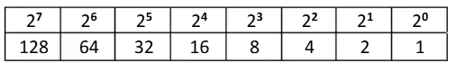
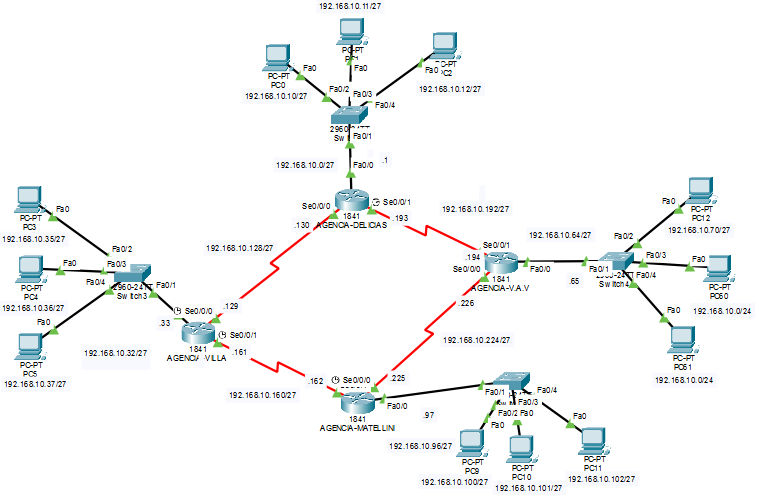

# VLSM (Variable length subnet mask)
> **Máscara de red de longitud variable**
Es una técnica que permite dividir una red IPv4 en subredes de **diferentes tamaños**, optimizando el uso de direcciones IP y evitando el desperdicio que genera el subnetting tradicional (máscara fija).

## 📐 Fórmulas básicas

### Cantidad de subredes
```
2^n ≥ # de subredes necesarias
```
> **n** = bits prestados de la porción de host

### Cantidad de hosts por subred
```
2^h − 2 = hosts útiles
```
> **h** = bits que quedan para hosts (32 − máscara)
> Se restan 2 por la **dirección de red** y la **dirección de broadcast**

---
## Ejemplo
4	agencias	(Delicias,	Villa,	V.A.V.	y	Marellini),	cada	una	con	router,	switch	y	3	PCs,	unidas	por	4	enlaces
seriales	en	anillo.	Hacen	falta	8	subredes	(4	LAN	+	4	enlaces)	y	enrutamiento	(estático	o	dinámico)	para	que	todas	se	comuniquen

### Paso 1: Calcular bits prestados
> representación de los 8 bits de un octeto en IPv4, con su valor decimal correspondiente.

```
2^n ≥ 8
2^3 = 8  →  n = 3 bits
```

### Paso 2: Nueva máscara
> 11111111.11111111.11111111.00000000 -> /24
```
/24 + 3 = /27
```
> 11111111.11111111.11111111.11100000 -> /27
```
255.255.255.224
```

### Paso 3: Bits de host y hosts útiles
>  los 5 bits sobrantes en la red (ceros)
```
32 − 27 = 5 bits de host
2^5 − 2 = 30 hosts útiles
```

### Paso 4: Salto de subred
```
256 − 224 = 32
```

## 📊 Tabla de subredes

| # | red | ip inicial | ip final | Broadcast |
|---|--------|--------------|-----------|-----------|
| 1 | 192.168.10.0 | 192.168.10.1 | 192.168.10.30 |192.168.10.31 |
| 2 | 192.168.10.32 | 192.168.10.33 | 192.168.10.62 | 192.168.10.63 |
| 3 | 192.168.10.64 | 192.168.10.65 | 192.168.10.94 | 192.168.10.95 |
| 4 | 192.168.10.96 | 192.168.10.97 | 192.168.10.126 | 192.168.10.127 |
| 5 | 192.168.10.128 | 192.168.10.129 | 192.168.10.158 | 192.168.10.159 |
| 6 | 192.168.10.160 | 192.168.10.161 | 192.168.10.190 | 192.168.10.191 |
| 7 | 192.168.10.192 | 192.168.10.193 | 192.168.10.222 | 192.168.10.223 |
| 8 | 192.168.10.224 | 192.168.10.225 | 192.168.10.254 | 192.168.10.255 |

---
> [!TIP] 
> Truco	del	docente:	llenar	la	tabla	de	atrás	hacia	adelante.	La	última	red	termina	en	.255;	la	anterior	termina	en	broadcast	−	1.	IP	inicial =	red	+	1,	IP	final	=	broadcast	−	1.

---

## ⚡ VLSM vs Subnetting fijo

| Característica | Subnetting fijo | VLSM |
|----------------|-----------------|------|
| Tamaño de subredes | Igual para todas | Diferente según necesidad |
| Desperdicio de IPs | Alto | Mínimo |
| Complejidad | Baja | Media |
| Uso típico | Redes pequeñas | Redes grandes / WAN |

---

## 📝 Notas clave

- La **primera IP válida** se usa normalmente como **gateway**.
- La **dirección de red** y la de **broadcast** NO se pueden asignar a hosts.
- En VLSM, el orden de asignación importa: **de mayor a menor**.
- Los enlaces seriales punto a punto usan máscara **/30** (2 hosts útiles).


## 💡 Aplicacion en cisco packet tracer 
[📦 Descargar archivo de Packet Tracer](sessiones/s9-Enrutamiento%20estatico%20con%20subneto.pkt)


### Configuración LAN
```
AGENCIA-DELICIAS#show history
  enable
  configure terminal
  hostname AGENCIA-DELICIAS
  configuración lan
  interface FastEthernet0/0
  ip address 192.168.10.1 255.255.255.224
  no shutdown
  exit
```
### Configuración WAN
```
  interface Serial0/0/0
  ip address 192.168.10.129 255.255.255.224
  clock rate 64000
  no shutdown
  interface Serial0/0/1
  ip address 192.168.10.194 255.255.255.224
  no shutdown
  exit
```
### Configuración estatica 
```
  ip route 192.168.10.32 255.255.255.224 192.168.10.129
  ip route 192.168.10.64 255.255.255.224 192.168.10.194
  ip route 192.168.10.96 255.255.255.224 192.168.10.129
  ip route 192.168.10.96 255.255.255.224 192.168.10.194
  end
  wr
  exit
  show ip route
```
